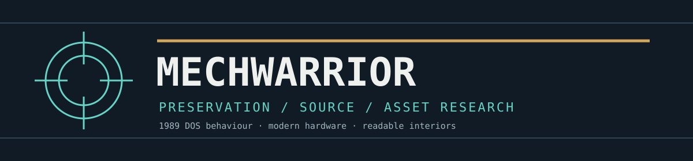

<p align="center"></p>

# MechWarrior SDL port

A readable, assembly-loyal C17/SDL3 reconstruction of **MechWarrior (1989)**.
The aim is preservation: run the original game behaviour on modern hardware
and expose its interior—BattleMechs, weapons, pilots, contracts and renderer—for
education and research. This is not a redesign, remake or original asset pack.

**A legally obtained original game installation is required. No original game
executables or data files are distributed.** See [the rights notice](docs/NOTICE.md) and the
[licensing map](docs/LICENSES/README.md). This is an independent, unofficial project.

## Status

Experimental playable Windows x64 EGA/PC-speaker build, not a finished v1.0.
The real campaign/launcher chain reaches briefing, movement, firing and combat
return. Campaign travel, Bar/recruitment, contracts, Mech repair/rearm and trading
are connected. A local Support-pilot defence victory was recorded; that does not
certify the full campaign, all scenarios, adapters or audiovisual fidelity.
The approved default speed remains **2500 reference CPU cycles/ms**.

See [runtime status](docs/RUNTIME_STATUS.md) for current gameplay limits.
Research tooling and verification suites are maintained separately in the
reverse-engineering repository, not bundled with this public game.

| Campaign planet hub | Combat gameplay |
| --- | --- |
|  |  |

[More real runtime captures and provenance](docs/SCREENSHOTS.md).

## Build and play

Requirements: Windows x64, Visual Studio C++ and CMake tools, PowerShell, and an
existing SDL3 package/source tree.
Dependencies are not silently downloaded.

```powershell
# Compile the platform-independent library without SDL or original game files:
./src/Build.ps1 -Headless -Configuration Release

# Supply your SDL3 installation (or use -SDLSourceDirectory):
./src/Build.ps1 -Configuration Release -SDL3Directory 'D:/Libraries/SDL3/cmake'

# Game data remains in your own installation:
./src/Run-MechWarrior.ps1 -GameDirectory 'D:/Games/MechWarrior'
```

Alternatively place private files in ignored `assets/original-game`. Saves and
F12 captures go to ignored local directories, not into the original installation.
The runtime reads original executable-authored tables as well as resource files;
copying just the TBL/BMP assets is insufficient. Keep SDL3.dll next to the built
executable. Open `MechWarrior.slnx` for Visual Studio source navigation.
The [reviewed executable hashes](docs/SUPPORTED_VERSIONS.md) identify the tested revision.
See [build instructions](docs/BUILDING.md) for direct CMake and Visual Studio setup.

Arrows/Enter operate campaign menus. In combat: Up/Down throttle, Left/Right
turn, Space fire, Tab fire all, Enter target, C command, D damage, E target
damage, Q return, T map, Z zoom, P pause. Repair and rearm before deployment.
F12 captures actual output. See [controls and testing](docs/PLAYABLE_TEST_BUILD.md).
Optional Support pilot is disabled unless explicitly requested; it is not native AI.

## Find your way around

| Path | Responsibility |
| --- | --- |
| `src/Original/Campaign` | MW_MAIN: economy, planets, contracts, pilots, Mech services |
| `src/Original/Combat` | BTECH: units, movement, AI, weapons, damage and mission loop |
| `src/Original/Geometry`, `Video`, `Audio` | Original projection/raster and sound/music logic |
| `src/Original/Memory` | Canonical typed state and executable-derived initialisation |
| `src/SDL` | Narrow file/input/time/audio/video host boundaries |
| `src/Support` | Necessary representation bridges and optional automation |
| `src/include/mechwarrior` | Shared typed records and interfaces |
| `src/Build.ps1`, `src/Run-MechWarrior.ps1` | Build and launch scripts |
| `docs` | Current user, gameplay, code and licensing guides |

Start with [code/data guide](docs/CODE_GUIDE.md), [BattleMechs and weapons](docs/GAME_DATA.md),
[documentation index](docs/README.md), [preservation policy](docs/PRESERVATION_PLAN.md)
and [code style](docs/CODE_STYLE.md). Runtime identifiers use readable names;
native annotations and symbol mappings stay in the reverse-engineering repository.

The separate [MechwarriorTools](https://github.com/Elthial/MechwarriorTools) repository contains the .NET desktop asset
viewer/editor and CLI, not another game engine. Neither project includes the game.
