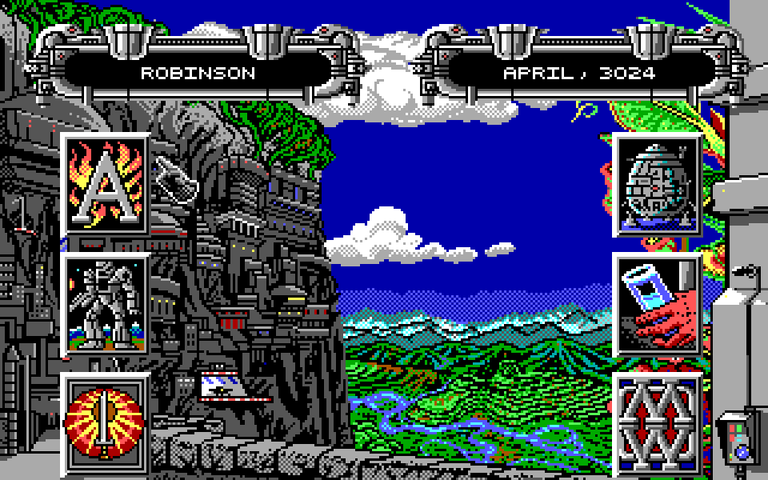
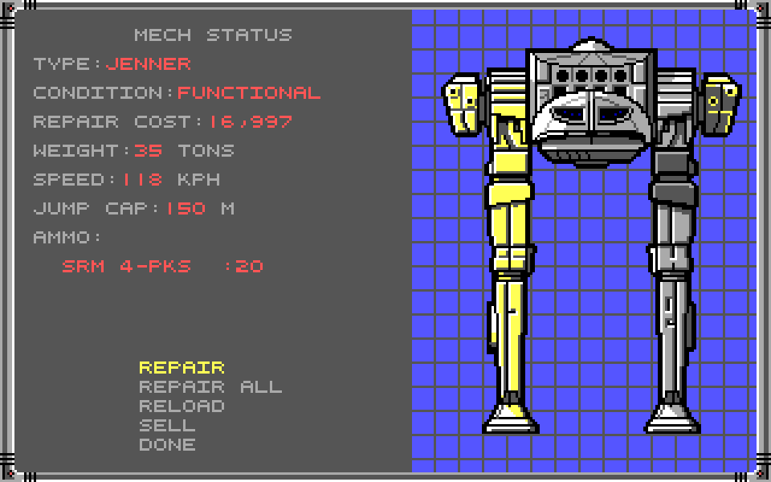
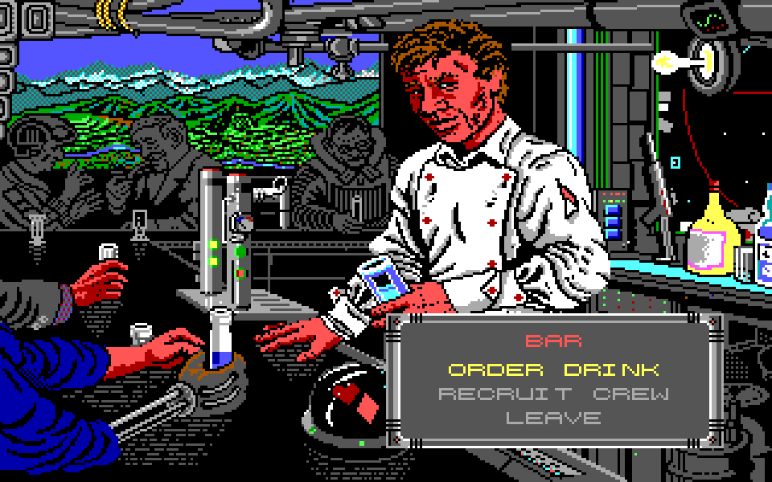
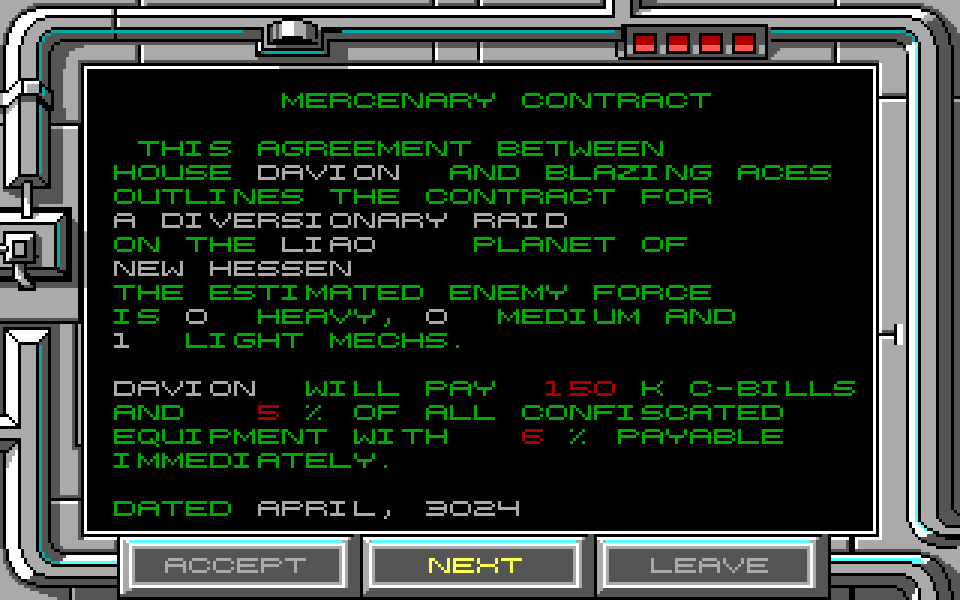
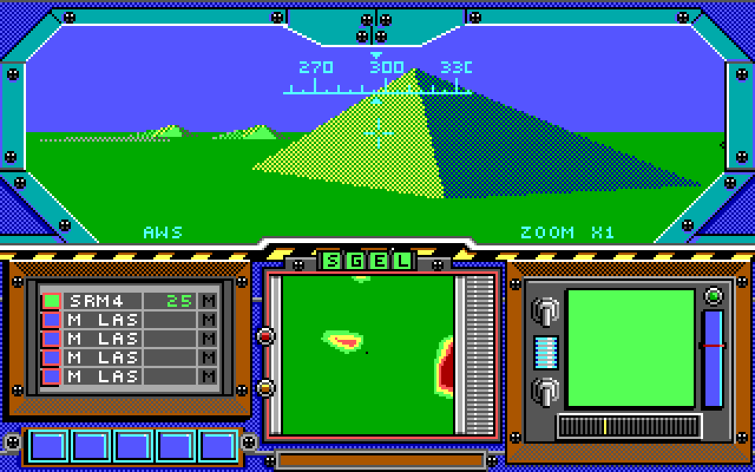

# Actual runtime screenshots

These are real reconstructed-game SDL renderer readbacks from recorded local
test sessions, not original-DOS screenshots, attached reference pictures, AI
images or recreated UI. Source/runtime C is unchanged by this repository split.
Lossless PNG encoding retains all source RGB pixels. No resizing or retouching
was applied. They demonstrate connected screens, not matched-original acceptance.

| Planet hub | Mech service / damaged Jenner |
| --- | --- |
|  |  |

| Bar | Contract briefing |
| --- | --- |
|  |  |

Campaign screens are from 2026-10-15 Release SDL tests. The cockpit is from the
2026-10-18 real Support-pilot combat test session. It is not claimed to be a
new manual mission completion or a capture of this standalone binary. Fresh
build/test scope is described in [runtime status](RUNTIME_STATUS.md).

[PROVENANCE.json](images/PROVENANCE.json) records source/output SHA-256, sizes,
capture descriptions and processing. Only these selected documentation images
are public; game resource files, indexed planes, palettes, audio, saves and raw
capture sets remain private. Original artwork in these screenshots is excluded
from MIT and not offered for reuse. See [the rights notice](NOTICE.md).

The SVG banner is independently drawn project typography and a reticle, not
the original title/logo. It makes no claim to original graphic ownership.
